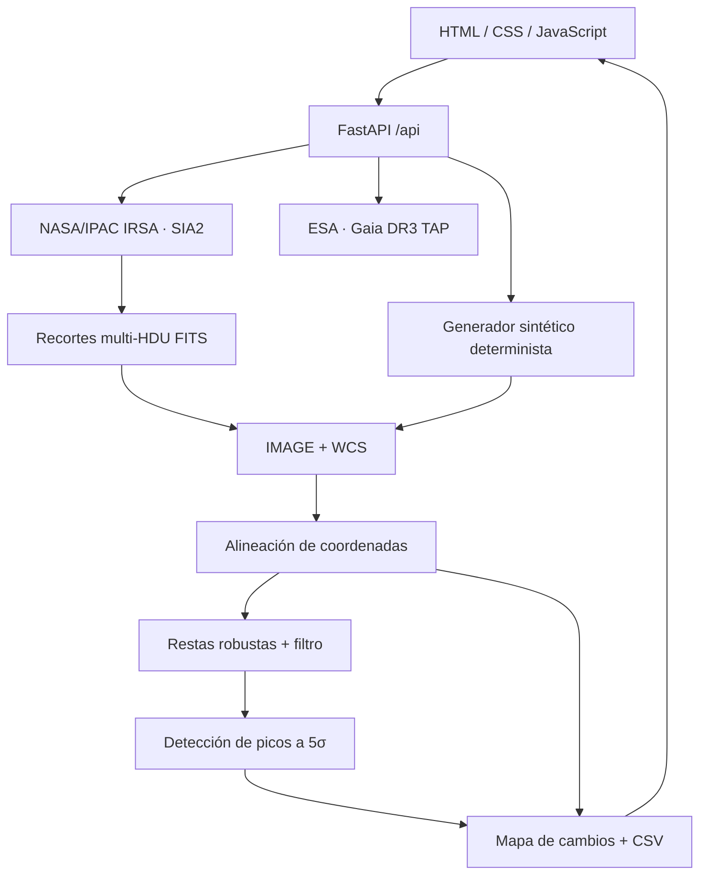

# Arquitectura — Planet X Explorer

## Idea de producto

En vez de prometer que encontraremos Planeta Nueve, construimos una herramienta pública y comprensible para explorar, comparar y aprender con datos astronómicos. El reto de detección se convierte en un proceso científico transparente: región → observaciones → comparación → señales → revisión.

## Diagrama de flujo

## Responsabilidades del equipo

- `api`: validación de entrada, límites, formato JSON, estados HTTP.
- `services`: conexión a archivos externos, procedencia y caché.
- `analysis`: operaciones de imágenes, alineación, candidatos preliminares.
- `frontend`: experiencia accesible, visualización, búsqueda, educación.
- `docs` y `tests`: credibilidad y reproducibilidad de las afirmaciones.

## Endpoints

| Método | Endpoint | Uso |
|---|---|---|
| GET | `/api/health` | Estado del servidor |
| GET | `/api/presets` | Campos de ejemplo |
| GET | `/api/observations?mode=demo\|real&ra=...&dec=...&radius=...` | Épocas sintéticas o búsqueda real SIA2 |
| POST | `/api/compare` | Crear sesión y PNG alineados; cuerpo `search_id,first_id,second_id` |
| GET | `/api/image/{id}/a\|b\|difference` | PNG de referencia/comparación/diferencia |
| GET | `/api/detect/{id}` | Candidatos preliminares en el frame de referencia |
| GET | `/api/gaia?ra=...&dec=...&radius=...` | Consulta complementaria (ESA) |
| GET | `/api/academy` | Contenido de lecciones y quiz |
| GET | `/api/sources` | Fuentes oficiales |
| GET | `/docs` | Swagger de FastAPI |

## Rendimiento y seguridad

- Sesiones limitadas a 30 búsquedas / 8 comparaciones en memoria (versión local monousuario).
- Búsquedas remotas limitadas a 85 resultados por colección y 90 mostrados.
- Recortes FITS limitados por tamaño, tiempos de espera y origen IRSA estricto, no acepta URL externa arbitraria (mitigación SSRF).
- No hace llamadas desde el navegador directamente a IRSA; evita CORS.
- No hay base de datos: `data/cache` conserva FITS en local para repetir comparaciones.
- La app se sirve localmente en `127.0.0.1`, no abierta a Internet.
- La sesión del navegador se pierde al reiniciar; el progreso educativo se guarda en localStorage.

## Posibles extensiones

- Mejorar a mosaicos espectrales equivalentes a longitud de onda constante, controles de PSF y errores VARIANCE.
- Cruzar automáticamente con Gaia, WISE y bases de objetos menores, y mostrar coincidencias con incertidumbre.
- Alinear y analizar tres o más épocas con ajuste de trayectoria; evitar extrapolaciones de una diferencia de dos imágenes.
- Persistir metadatos y resultados en SQLite; exportar paquete de reproducibilidad.
