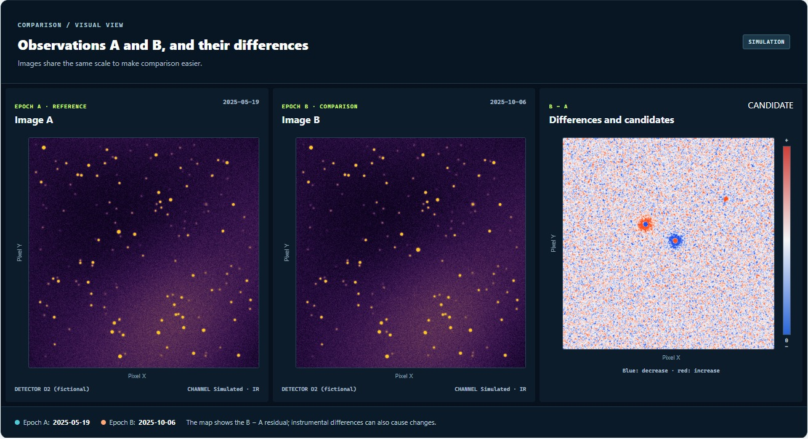
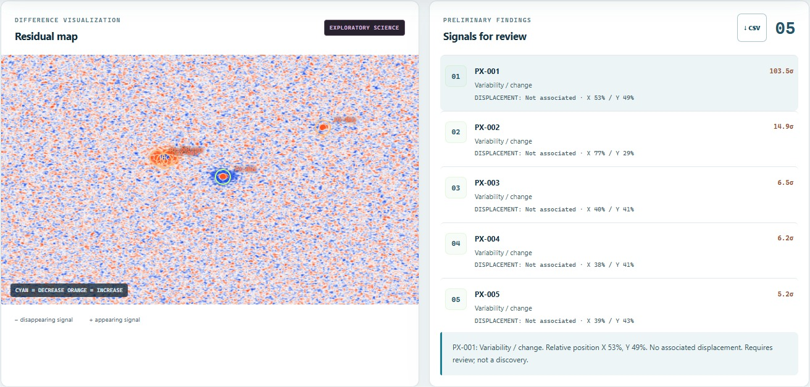

# PLANET X EXPLORER

## Technical report and project presentation

**Explore changes in the sky. Understand before concluding.**

An educational platform for comparing infrared images, reviewing preliminary signals and learning the astronomical investigation process.

| Project profile | Information |
| --- | --- |
| Location | Cajamarca, Peru |
| Development period declared by the team | 14–15 November 2026 |
| Delivery model | Educational web prototype; local, on-demand execution |
| Repository | 12FOCUS21/planet-x-explorer |
| Delivery status | Public source code and local tests; no public application deployment |
| Institution / competition | Not specified by the team |

### Team

- Carrasco Burga Jesús David
- Regalado Cabrera Alexander
- Huamán Zegarra Jordi Fernando
- Pérez Quiliche Dany Alexander
- Calua Terán Jhon Emerson

Responsibilities are distributed equitably, with shared review. Individual reference areas below are a proposed organization, not a historical authorship or time record.

Version: English edition, based on the professional Spanish report and the bilingual application update. Select **English** in the live application header. The project is independent and has no official NASA or ESA endorsement. Demo pixels are synthetic and do not constitute evidence of a planet.

<!-- page -->

# 1. Project summary

Planet X Explorer makes astronomical exploration understandable through a visual workflow: select a sky region, choose two epochs, compare images and review differences. Interest in the hypothetical Planet Nine provides the educational context, but the project does not claim to have detected it.

Two modes remain separate. Demo creates four reproducible synthetic epochs and works without external services after dependencies are installed. IRSA mode requests SPHEREx metadata and cutouts on demand. Visible source labels prevent simulations from being confused with measurements. The application now supports Spanish and English, including lessons, quiz, dynamic states and exported descriptions.

## 2. Project demonstration

YouTube/video link: **pending recording and publication**. A proposed 30-second script appears in Appendix A. A longer 4–5 minute scene-by-scene guide is available in COMPLETE_VIDEO_GUIDE.md. A prepared script is not a completed video.

## 3. Project link

**Public repository: 12FOCUS21/planet-x-explorer**

https://github.com/12FOCUS21/planet-x-explorer

The repository contains source code, technical documents and project reports. Environments, downloaded dependencies and FITS caches are deliberately excluded. Public code does not mean the application is publicly running. The local address http://127.0.0.1:8000 only works on the computer running the server.

## 4. Project details — executive summary

| Element | Executive overview |
| --- | --- |
| Problem | Astronomical images and their changes are difficult to interpret without technical and educational context. |
| Solution | A/B/B − A comparison with guided navigation, preliminary signal review and an academy. |
| Audience | Students, educators, interested non-specialists and technology-project evaluators. |
| Evidence | Historical 39-test release, synthetic smoke and UI QA; the bilingual update expands the Python suite to 44 tests. |
| Main constraint | No confirmed planet, independent scientific validation or public deployment. |
| Operating model | Intended hosting budget: USD 0. On-demand use, not a permanent service. |

<!-- page -->

# 1. Project description

## 1.1. What does it do?

Users enter right ascension, declination and a cutout radius, or choose a suggested field. They search available epochs, select a compatible pair and view A, B and the B − A residual map.

- Select a preliminary peak and inspect its position.
- Adjust the heuristic threshold from 2 to 10 σ, initially 5 σ.
- Export a CSV retaining the origin and preliminary-status disclaimer.
- Read three lessons and answer a five-question quiz.
- Switch Spanish/English without discarding the current comparison or quiz answer.

## 1.2. How does it work?

| Stage | Processing and output |
| --- | --- |
| Selection | The browser collects the region and mode. Opening IRSA or changing language does not start a search. |
| Acquisition | Demo: four artificial 440 × 440 scenes. IRSA: DR1, QR3 and their deep collections, with no QR2 fallback. |
| Compatibility | Real data require the same collection/detector, distinct timestamps and at least 80% overlap of declared spectral ranges. |
| Comparison | Read FITS IMAGE, reproject B onto A with WCS in the real-data route, remove background and compute the residual. |
| Review | Generate three PNGs and highlight peaks. Robust noise uses MAD; σ is not a planet probability. |

Flow: browser → FastAPI → synthetic generator or IRSA → A/B → processing → images and signals → human review.

## 1.3. Innovation and purpose

The contribution is an integrated educational experience: explicit provenance, visual comparison, interactive controls and methodological explanations. The detector is not claimed as a novel astronomical technique or autonomous discovery system.

Comparison progress follows confirmed milestones and reaches 100% only after the images load. Search and analysis stay indeterminate while waiting. The interface supports mobile, keyboard navigation and reduced-motion preferences. Local translation does not change scientific values, IDs, dates or coordinates.

<!-- page -->

# 1.4. Benefits and impact

## A. Social, environmental and technological benefits

- Social: encourage scientific/digital literacy and critical interpretation of uncertainty and evidence.
- Technological: combine archive access, image processing and interactive controls in a reproducible public-source prototype.
- Environmental: no direct environmental benefit or emissions reduction has been measured. On-demand use avoids requiring a permanent service, but energy savings cannot be quantified from the available evidence.

## B. SDGs and space-mission relevance

The proposed main alignment is with SDG 4, Quality Education, through learning materials and scientific reasoning. A secondary conceptual relationship is SDG 9, Industry, Innovation and Infrastructure, through technical capacity building. This is not certification or a measured contribution to UN targets.

For SPHEREx, the project promotes educational understanding of infrared archives and data-use limitations. It is not part of mission operations and does not provide validated scientific findings to NASA.

## C. Expected community impact

From Cajamarca, the team proposes classroom demonstrations, technology fairs and outreach. Participants should learn to distinguish simulation from observation, interpret an image difference and explain why a signal needs further checks. No user study has yet measured this impact. English documentation and interface support make the presentation accessible to the jury without changing the scientific scope.

## 1.5. Objectives and expected results

General objective: develop an educational prototype for exploring and comparing two epochs with explicit provenance and responsible interpretation.

| Specific objective | Review criterion |
| --- | --- |
| Separate Demo and real data | Explicit labels and no hidden synthetic replacement on IRSA failure. |
| Make comparison visible | Reveal A, B and B − A only after their loading completes. |
| Support exploratory analysis | Adjustable threshold, signal selection and CSV export. |
| Support learning | Lessons and quiz; user evaluation remains future work. |
| Enable reproduction | Document installation and tests without permanent hosting. |
| Offer both languages | Persistent selector and translated documents, states and learning material. |

<!-- page -->

# 1.6. Methodology and work plan

The team used an iterative approach: define scope, integrate components, check the workflow and document limits. The declared original period was 14–15 November 2026. The table organizes phases within that interval; no detailed hourly or per-day activity log was supplied. The bilingual enhancement is documented as a subsequent functional update, not evidence of an invented schedule.

| Phase | Main activities | Deliverable or evidence |
| --- | --- | --- |
| Definition · 14–15 Nov | Define audience, educational workflow and source separation. | Scope and user journey. |
| Integration · 14–15 Nov | Connect interface, API, synthetic scenes and archive route. | Local prototype and three image views. |
| Experience · 14–15 Nov | Improve states, errors, mobile navigation and signal review. | Guided interface and interactive controls. |
| Verification · 14–15 Nov | Python, synthetic smoke and browser checks. | 39 passing tests in the earlier documented release. |
| Delivery · 15 Nov closing | Publish code and guide; prepare report and demonstration. | Public repository/documents; video pending. |
| Bilingual enhancement | Spanish/English UI, API localization and language-separated documents. | Expanded local tests and jury materials. |
| Continuation · undated | Verify real downloads, assess learning and improve calibration. | Proposed future plan, not completed. |

## Closing activities

- Exercise Demo from search through comparison and signal review.
- Check empty/error states without fabricating results or mixing sources.
- Explain installation, references and restrictions for another team to reproduce.
- Preserve version history while excluding environments and FITS cache.

## Risks and controls

| Risk | Control |
| --- | --- |
| Network failure or unavailable coverage | Show error/empty state; use a separately identified Demo. |
| Misinterpreting a signal | Preliminary labels and explanation of instrumental limits. |
| Limited time/budget | Prioritize local, on-demand execution; no paid hosting. |
| Confusing source publication with deployment | Explicitly distinguish GitHub from a running application URL. |

<!-- page -->

# 1.7. Methodology and tools

## 1.7.1. Tools and software

| Component | Tools and role |
| --- | --- |
| Scientific arrays | NumPy/SciPy: matrices, filtering, robust noise estimates and peak search. |
| Astronomy | Astropy/WCS reprojection utilities: FITS reading and celestial alignment. |
| Archive communication | HTTPX, SIA2 and optional ESA Gaia DR3. |
| Tests | pytest, synthetic smoke, Playwright/Edge and axe. |
| Versioning | Git and GitHub, repository 12FOCUS21/planet-x-explorer. |
| AI assistance | OpenCode with Sol 6.1, Astra and DeepSeek, as declared by the team. |
| Documentation | Markdown, professionally formatted Word/PDF, separate Spanish/English folders. |

## 1.7.2. Programming languages and framework

Backend: Python 3.12 and FastAPI. The server validates entries/pairs, manages comparison jobs and returns JSON/PNG. Frontend: HTML, CSS and JavaScript without a mandatory compilation step. The browser does not directly process remote FITS.

Architecture separates api/ endpoints, services/ acquisition, analysis/ alignment/detection, utils/ FITS/rendering, frontend/ interface, tests/ verification and docs/ explanation. Searches and sessions remain temporarily in memory. Cutouts may be cached locally and are not committed.

The bilingual update uses a bundled translation catalogue and reversible presentation layer. API clients can request English JSON with ?lang=en or Accept-Language: en. The browser keeps canonical workflow messages internally and translates display text; scientific values and data provenance remain unchanged.

## 1.7.3. Hardware and sensors

A general-purpose Windows computer and modern browser are used. Demo does not require a telescope, electronics board, physical sensor or dedicated GPU. No formal CPU/RAM minimum or performance benchmark has been established.

Internet is required for initial installation and real archive queries. Demo works without external connectivity after installation while the local server is running. SPHEREx detectors are mission hardware, not equipment owned by the team.

## Methodological principle

A working prototype is not a calibrated scientific instrument. Software checks, data validation, educational evaluation and astronomical conclusions are different forms of evidence.

<!-- page -->

# 1.8. Project management

The five team members are based in Cajamarca, Peru. Work is distributed equitably with cross-review. The following reference areas are proposed for this report, not a historical record of individual authorship or hours.

| Team member | Proposed reference area | Shared responsibility |
| --- | --- | --- |
| Carrasco Burga Jesús David | Coordination and integration | Review scope, user journey and delivery coherence. |
| Regalado Cabrera Alexander | Services and processing | Review provenance, API and result limitations. |
| Huamán Zegarra Jordi Fernando | Interface and experience | Review navigation, states, mobile and visual clarity. |
| Pérez Quiliche Dany Alexander | Testing and reproduction | Review checks, errors and technical instructions. |
| Calua Terán Jhon Emerson | Outreach and documentation | Review report, learning explanation and video preparation. |

## Collaboration

- Make decisions by consensus and distribute comparable effort.
- Review claims about data provenance and scientific results together.
- Track changes with Git and maintain a shared delivery checklist.
- Rehearse presentation so knowledge does not depend on one person.

## Resources, budget and delivery status

| Resource | Condition |
| --- | --- |
| Hosting | Intended budget USD 0; no verified public deployment. |
| Execution | Started locally for development, testing or demonstration only. |
| Equipment/connectivity | Existing team resources; monetary valuation not provided. |
| Source code | Public GitHub repository; environments and FITS caches excluded. |
| Presentation | English/Spanish documentation; video remains pending. |

Institution, advisor and competition were not specified. No sponsors, institutional partnerships or certifications are attributed. OpenCode is the AI-assisted development environment, not a project sponsor or scientific validator.

<!-- page -->

# 1.9. Project location

The project is developed in Cajamarca, Peru. Use is digital: local demonstrations can be shown in classrooms or fairs through a browser. Astronomical coordinates select parts of the sky, not the team's geographical location. No observing station or territorial deployment is associated with the prototype.

## Justification

Access to an archive does not guarantee understanding its data. A controlled synthetic scene, visible processing and scientific explanations reduce the entry barrier. Users can first learn the procedure, then cautiously explore observations through a separate archive route.

## 1.10. Impact and benefits

NASA relevance comes from educational access to SPHEREx through NASA/IPAC IRSA and explaining infrared observations. There is no contract, official affiliation or validated contribution to mission science. Gaia belongs to ESA and provides auxiliary context, not automatic classification.

## 1.11. Expected results and available evidence

| Result | Status and evidence limits |
| --- | --- |
| Demo/visual comparison | Implemented; synthetic smoke produces three PNGs and preliminary signals. |
| Backend quality | Earlier 39-test release; bilingual suite expanded to 44 Python checks. Software checks are not scientific validation. |
| Interface/accessibility | Edge/axe checks of selected desktop/mobile states, language switching and reduced motion. Not comprehensive certification. |
| Real archive route | Search/cutout code exists; a new complete real download was not verified in the preceding review. |
| Educational impact | Expected; not measured with students or community participants. |
| Publication | Public source and documents, not a deployed application; video pending. |

Browser QA intercepts empty/error IRSA responses locally. This proves interface behaviour, not live archive coverage or download availability. Signal counts depend on epochs and threshold and are not astronomical findings.

<!-- page -->

# 1.12. Conclusions and future improvements

Planet X Explorer integrates epoch comparison, visible provenance, exploratory signals and learning content into an educational prototype. Its value is making the process understandable, not confirming an astronomical object. Available evidence supports local functionality and software checks, not measured learning effectiveness or scientific accuracy.

## Lessons learned

- Separating simulation from observation is a scientific-communication requirement.
- Percentages should reflect confirmed facts, not an animated suggestion of elapsed progress.
- A bright residual can be noise, variability or an instrument effect; uncertainty and context matter.
- With a zero-hosting budget, reproducible local execution is more defensible than promising a permanent service.
- Translation should improve access without changing data or erasing the original technical history.

## Proposed improvements

| Priority | Improvement | Evidence needed |
| --- | --- | --- |
| High | Verify IRSA end to end. | Query/collection/timestamp/file records and reproducible result. |
| High | Add LVF, FLAGS, VARIANCE and PSF controls. | Instrumental review and tests with control fields. |
| Medium | Known-object checks and multiple epochs. | Catalogue comparison and independent validation. |
| Medium | User comprehension/usability study. | Evaluation instruments, sample and measured results. |
| Conditional | Public on-demand deployment. | Authorization, current free-tier terms and external test. |

## 1.13. Appendices

Appendix A provides the short video script. Appendix B shows local QA captures of the English interface. Sources are listed in sections 6–7. Screenshots illustrate synthetic UI results, not real detections. Original Spanish evidence is retained separately in the Spanish report.

## Essential scientific limit

Matching collection and detector does not verify per-pixel LVF equivalence. Masks, uncertainties and PSF correction are incomplete; no orbital fit or systematic exclusion of all known objects is performed. A 5 σ signal does not prove a planet.

<!-- page -->

# 5. Use of artificial intelligence

The team used AI assistance in development, code review, testing support and documentation through **OpenCode**. OpenCode is the development environment for interacting with models and tools; it is not itself a language model.

- **OpenCode:** AI-assisted programming and documentation environment.
- **Sol 6.1, Astra and DeepSeek:** models used within OpenCode, as declared by the team.
- **Tasks supported:** proposals and revisions to code, interpretation of errors, support for test execution/review, documentation and presentation preparation.
- **Accountability:** the team reviews decisions and approves deliverables; AI does not establish scientific validity or confirm a planet.

Exact Astra/DeepSeek versions and a model-by-model activity log were not provided. No undocumented individual contribution, model capability or supplier identity is invented. The public repository preserves code/history but does not identify the authoring model for every line.

## 6. NASA data and technical references

Real access uses NASA/IPAC IRSA with spherex_dr1, spherex_qr3 and their deep variants. Requests are on demand and compatible coverage is not guaranteed. Demo pixels are locally generated, not NASA data.

- SPHEREx data access: https://irsa.ipac.caltech.edu/spherex-archive-documentation/spherex-data-access/
- FITS image introduction: https://caltech-ipac.github.io/irsa-tutorials/spherex-intro/
- Cutouts: https://caltech-ipac.github.io/irsa-tutorials/spherex-cutouts/
- Project methodology: https://github.com/12FOCUS21/planet-x-explorer/blob/main/docs/en/methodology.md

## 7. Space-agency partners and other programmes

No sponsors, agency partnerships or agreements are declared. NASA/IPAC IRSA and ESA are sources, not project partners. Optional Gaia DR3 context does not automatically validate signals.

- ESA Gaia archive: https://gea.esac.esa.int/archive/
- SDG 4: https://sdgs.un.org/goals/goal4
- SDG 9: https://sdgs.un.org/goals/goal9

These references and proposed alignments do not imply new archive downloads during report preparation.

<!-- page -->

# Appendix A — 30-second video demonstration

Status: pending recording/publication. This is a proposed script for rehearsal, not evidence of a completed video. Use Demo and select English before recording.

| Time | Screen action | Proposed narration |
| --- | --- | --- |
| 0–5 s | Home and title. | “Planet X Explorer helps us learn to look for changes in the sky.” |
| 5–12 s | Four synthetic epochs, select A/B. | “In this synthetic Demo, we choose two epochs and compare them.” |
| 12–20 s | A, B and loaded difference map. | “Both images and their difference reveal preliminary signals for review.” |
| 20–26 s | Select a signal; keep synthetic label visible. | “The separate IRSA route queries observations on demand.” |
| 26–30 s | Close on sources or home. | “A signal does not confirm a planet: understand first, then verify.” |

## Preparation checklist

- Install dependencies in advance, start INICIAR_WINDOWS.bat and leave the server open.
- Open http://127.0.0.1:8000 on the same computer, select English and rehearse the full workflow.
- Keep simulation labels visible; wait for three PNGs before describing the result as ready.
- Hide personal notifications, check audio and ensure readable text.
- Once published, verify jury access and add the video URL to section 2.

## Showing IRSA in a longer presentation

Execute and document a real query/download before calling images real. If the network fails or no pair is returned, explain the limitation and return to the explicitly labelled Demo. Never narrate NASA observations over artificial scenes.

## Closing message

“We built a transparent tool for exploration and learning. We demonstrate a process for reviewing changes, not the discovery of Planet X.”

<!-- page -->

# Appendix B — visual evidence

Local QA captures of the English interface illustrate the workflow and source labels. Scenes and signals belong to the synthetic Demo. Crops focus on relevant controls without changing results. The Spanish report separately retains the original screenshots.

Figure 1. English interface: synthetic comparison with explicit simulation labels.

Figure 2. English interface: preliminary-signal map, classifications and human-review disclaimer.

A screenshot does not establish IRSA connectivity, scientific accuracy or comprehensive accessibility. Run the local prototype to inspect the complete behaviour.
