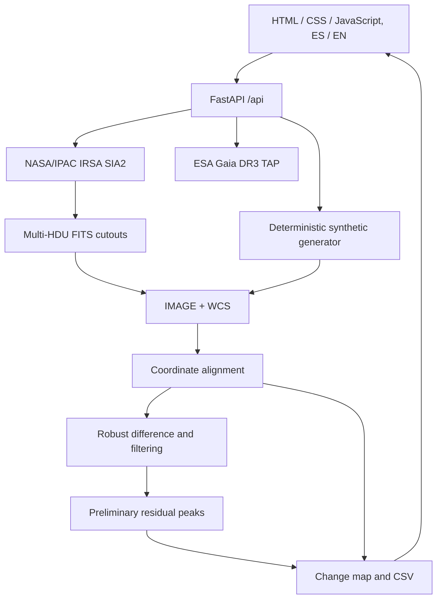

# Architecture — Planet X Explorer

[English](README.md) · [Español](../es/architecture.md)

> This translates a historical architecture record. Earlier limits of 85 records per collection/90 shown are obsolete; the current limit is 150 per collection. The initial 5 σ threshold is now adjustable from 2 to 10 σ. See [bilingual release](BILINGUAL.md).

## Product idea and flow

Rather than promising Planet Nine, provide a clear tool to explore, compare and learn: region → observations → comparison → signals → review.

## Responsibilities

- `api`: input validation, limits, JSON and HTTP statuses.
- `services`: external archives, provenance and cache.
- `analysis`: alignment, image operations and preliminary candidates.
- `frontend`: accessible navigation, visualization, search, learning and language selection.
- `docs`, `tests`: reproducibility and defensible claims.

## Endpoints

| Method | Endpoint | Purpose |
| --- | --- | --- |
| GET | `/api/health` | Server status |
| GET | `/api/presets` | Example fields |
| GET | `/api/observations?mode=demo&ra=...&dec=...&radius=...` | Synthetic epochs; `mode=real` requests SIA2 |
| POST | `/api/compare` | Legacy local comparison; body: `search_id,first_id,second_id` |
| POST | `/api/compare/jobs` | Start/reuse an asynchronous comparison |
| GET | `/api/compare/jobs/{id}` | Status, progress message and result |
| GET | `/api/image/{id}/{layer}` | PNG, layer `a`, `b` or `difference` |
| GET | `/api/detect/{id}?threshold_sigma=5` | Preliminary peaks in the reference frame |
| GET | `/api/gaia?ra=...&dec=...&radius=...` | Optional ESA query |
| GET | `/api/academy` | Lessons and quiz |
| GET | `/api/sources` | Official source links |
| GET | `/docs` | Local FastAPI Swagger; disabled in public mode |

JSON clients may use `?lang=en` or `Accept-Language: en`. Localization changes response strings, not session state, numeric values or identifiers. The browser keeps canonical Spanish API responses for workflow logic and localizes presentation using the bundled catalogue.

## Performance and security

- At most 30 searches and 8 comparison sessions remain in memory; this is a single-process local design.
- Remote requests, FITS dimensions, download sizes and timeouts are bounded.
- Downloads require the official IRSA origin, not arbitrary user URLs (SSRF mitigation).
- The browser does not query IRSA directly, avoiding a direct browser CORS dependency.
- No database; `data/cache` stores local FITS for reuse.
- Local binding is `127.0.0.1`. Optional public controls are not a security certification.
- Server restart loses sessions; educational progress and language preference remain in browser localStorage.

## Possible extensions

Equivalent-wavelength mosaics, PSF/VARIANCE control, catalogue matches with uncertainty (Gaia/WISE/minor planets), trajectories from three or more epochs, SQLite metadata and reproducibility bundles. These are proposed improvements, not delivered scientific capabilities.
